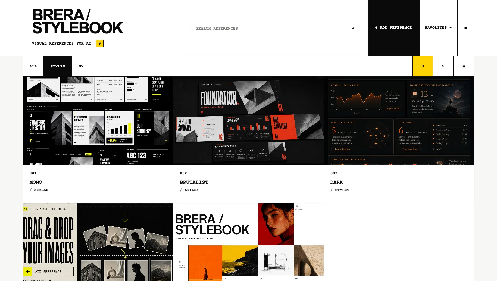
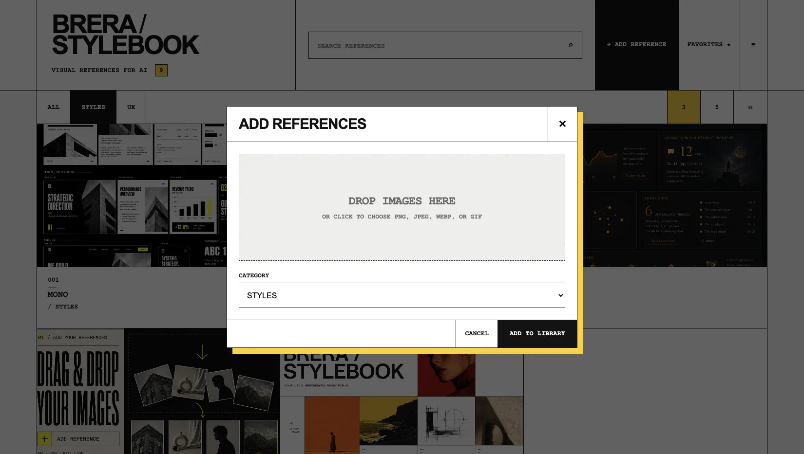
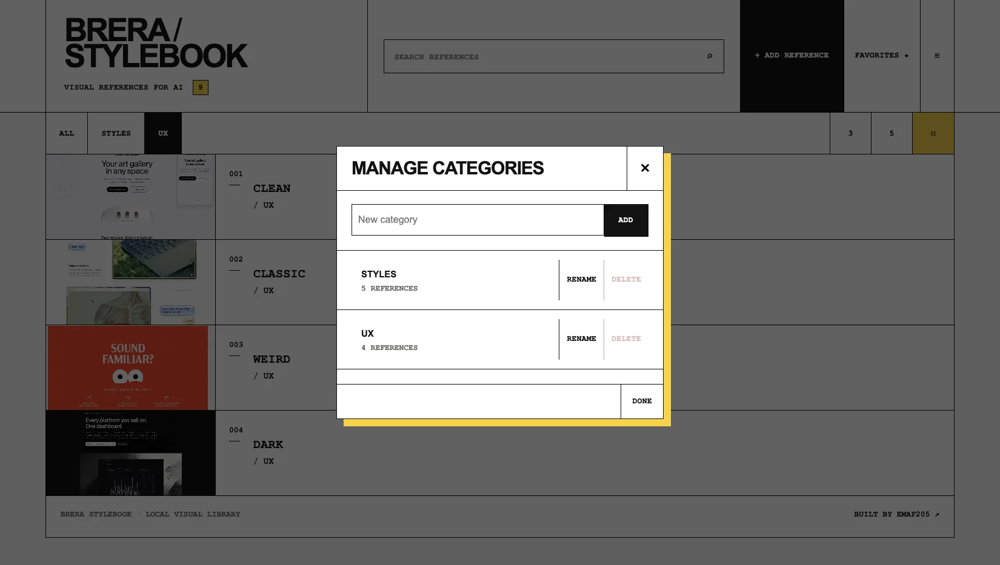
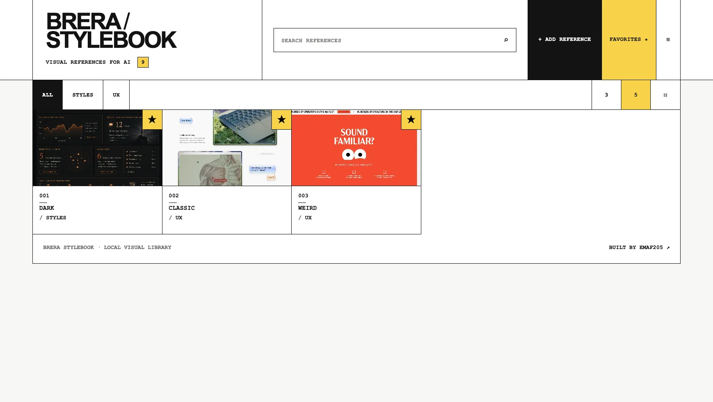
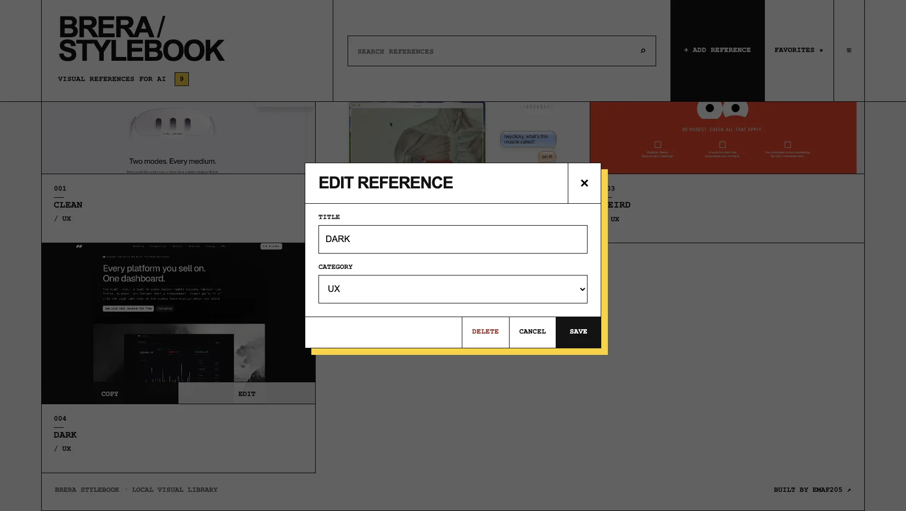

# BRERA StyleBook — Local-First Visual Reference Library for AI

<p align="center">
  
</p>

> **See it → Find it → Copy it → Reuse it.**  
> A lightweight, local-first visual library engineered for modern AI generative workflows. Keep your architectural, typographic, and art-directed reference prompts organized in your browser with zero server dependencies.

[](https://brera-stylebook.netlify.app/)
[](https://github.com/emaf205/BRERA-STYLEBOOK)
[](LICENSE)

---

## ✦ The Genesis & Why This Exists

If you work daily with generative AI models (ChatGPT, Midjourney, Stable Diffusion, Flux, Ideogram), you know the "reference chaos". You find a breathtaking poster, a rare typography specimen, or a specific Swiss grid layout. You screenshot it. It ends up buried in your `~/Downloads` folder, lost across browser bookmarks, or stranded inside Telegram saved messages.

When you actually sit down to prompt or art-direct an asset, you spend 15 minutes digging through directories just to find the reference image or prompt modifier.

I built **BRERA StyleBook** in Milan to eliminate this friction entirely. Named after Milan’s historic design and artistic district, it delivers a disciplined, local-first desktop workspace that does one thing with uncompromising precision:

**Store your visual references locally, categorize them instantly, and copy their prompt DNA into your AI tool with a single click.**

---

## ✦ Live Interface & Screenshots

<p align="center">
  
  
</p>

<p align="center">
  
  
  
</p>

---

## ✦ What Makes It Different

1. **100% Local-First & Private**:
   - Every reference, tag, and image is stored entirely inside your browser via IndexedDB and LocalStorage.
   - Zero telemetry, zero external database, zero tracking. Your proprietary design references and creative assets never touch an external server.
2. **One-Click Prompt Copy**:
   - Click any card to instantly copy its visual prompt formula to your clipboard, ready to paste directly into ChatGPT, Midjourney, or Antigravity.
3. **Flexible Visual Density**:
   - Toggle seamlessly between a 3-column showcase, 5-column compact inspection, and structured list views.
4. **Resilient Data Sovereignty**:
   - Instant JSON backup exports and smart restorations supporting both non-destructive **Merge** and clean **Replace** modes.
5. **Zero Compilation Overhead**:
   - Engineered purely with modern semantic HTML5, CSS Grid/Flexbox, and vanilla ES6+ JavaScript. No node dependencies, zero build step.

---

## ✦ Curated Foundation Categories

Out of the box, StyleBook comes seeded with curated reference buckets:
- **STYLES**: Avant-garde brutalism, Swiss International typography, CRT scanlines, 35mm film grain, risograph printing, and industrial Bauhaus grids.
- **UX & UI**: Micro-interactions, tactile mobile drawers, dashboard telemetry, and noble paper contrast palettes.

---

## ✦ Quickstart & Local Setup

```bash
# Clone the repository
git clone https://github.com/emaf205/BRERA-STYLEBOOK.git
cd BRERA-STYLEBOOK

# Run locally with any static server
python3 -m http.server 8080

# Or with Node
npx serve .
```

Open [http://localhost:8080](http://localhost:8080) in Chrome, Safari, or Arc.

---

## ✦ Technical Architecture

```text
BRERA-STYLEBOOK/
├── index.html           # Accessible semantic markup and grid views
├── styles.css           # Swiss typography, responsive column containers
├── app.js               # Reactive IndexedDB state manager and clipboard bridge
├── assets/              # Curated starter references and UI assets
├── netlify.toml         # Static hosting routing configuration
└── README.md            # Documentation
```

---

## ✦ Author & Credits

Designed and maintained by **[Emanuele BDC](https://emaf205.com)** in Milan.  
Built for designers, art directors, creative technologists, and architects who demand absolute control over their AI aesthetic workflows.

Distributed under the **MIT License**. Free for personal and commercial creative work.
